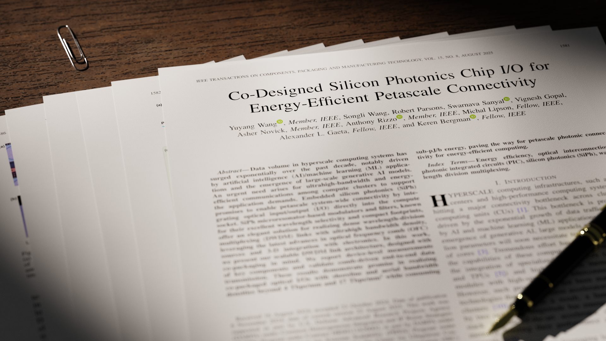

# PDF Paper Stack

Turn a PDF into a Blender-rendered paper stack for publication announcements.
Choose a spread of pages (`fan`) or a compact pile with visible page edges (`stack`).



## Setup

Install [Blender](https://www.blender.org/download/) and Conda. Blender must be
available as `blender`; tested with Blender 5.2 LTS. From the repository root:

```sh
make env
make assets-check
```

The Conda environment includes Python, Poppler and the Python dependencies.
Local scene assets and one sample PDF are included. Other configured papers are
examples of local inputs; their PDFs are not bundled.

Use `BLENDER=/path/to/blender` if needed. `PYTHON=/path/to/python` selects an
existing Python environment instead of Conda.

## Render

Try the bundled sample at preview quality:

```sh
make publish DPI=150 SAMPLES=64 RESOLUTION=960x540 DENOISE=1
```

`publish` builds and renders locally; it does not upload anything. The default
paper is `t-cpmt25`. Results go to `render/`, with an editable scene in `prj/`.

Use the compact layout, or render at the configured full quality:

```sh
make publish LAYOUT=stack DPI=150 SAMPLES=64 RESOLUTION=960x540 DENOISE=1
make publish LAYOUT=stack
```

The supplied full-quality settings are 600 DPI, 1920×1080 and 1024 samples.
Compact outputs include `_stack` in their names. The default layout is `fan`.

## Your own PDF

For a one-off render, reuse the sample configuration with separate output paths:

```sh
make publish PAPER_ID=t-cpmt25 PDF="/path/to/paper.pdf" \
  IMAGE_DIR=img/my-paper VARIANT=my-paper LAYOUT=stack
```

For repeated use, add a paper under `papers` in `config/pipeline.yml`:

```yaml
my-paper:
  pdf: pdf/my-paper.pdf
  images: img/my-paper
  blend: prj/my-paper.blend
```

Then run `make publish PAPER_ID=my-paper LAYOUT=stack`.

## Adjustments

- `VARIANT=1` or `VARIANT=hero` creates a separate, repeatable composition;
  `RANDOM_VARIANT=1` draws a new one. Choose one of these modes at a time.
- `config/pipeline.yml` controls camera, lighting and paper appearance;
  `config/assets.yml` controls the local assets.
- In `scene.stack.compact`, adjust `page_thickness`, `outlier_distance` and
  `edge_curl` for the pile, and `lighting` for illumination. `focus_uv` sets the
  focus point on the cover: `[0.5, 0.76]` means centered horizontally and 76% up
  from the bottom. Adjust it to your article's title position.
- `make workflow` builds without rendering. `make render` refreshes and renders
  the selected scene. To render a scene you edited in Blender as-is, use
  `make render BLEND=/path/to/scene.blend`.

Replaced outputs are kept under `history/`. For more command options, run
`make help`. Run `make test` for the pipeline checks.
